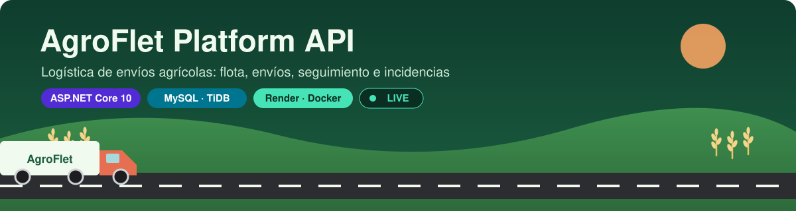
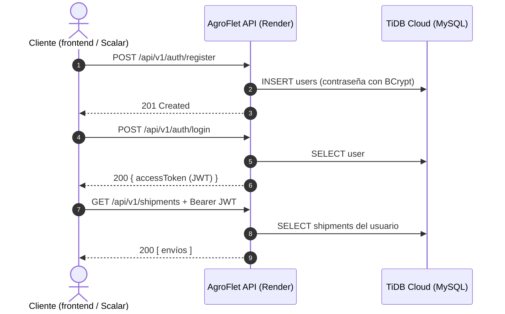
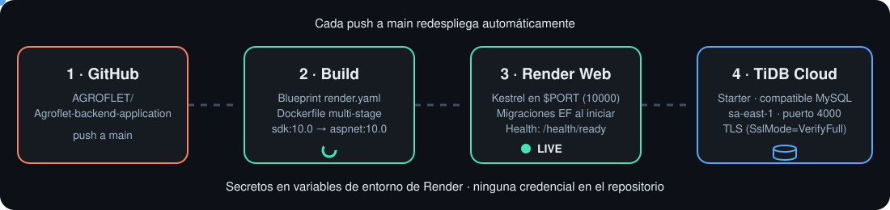
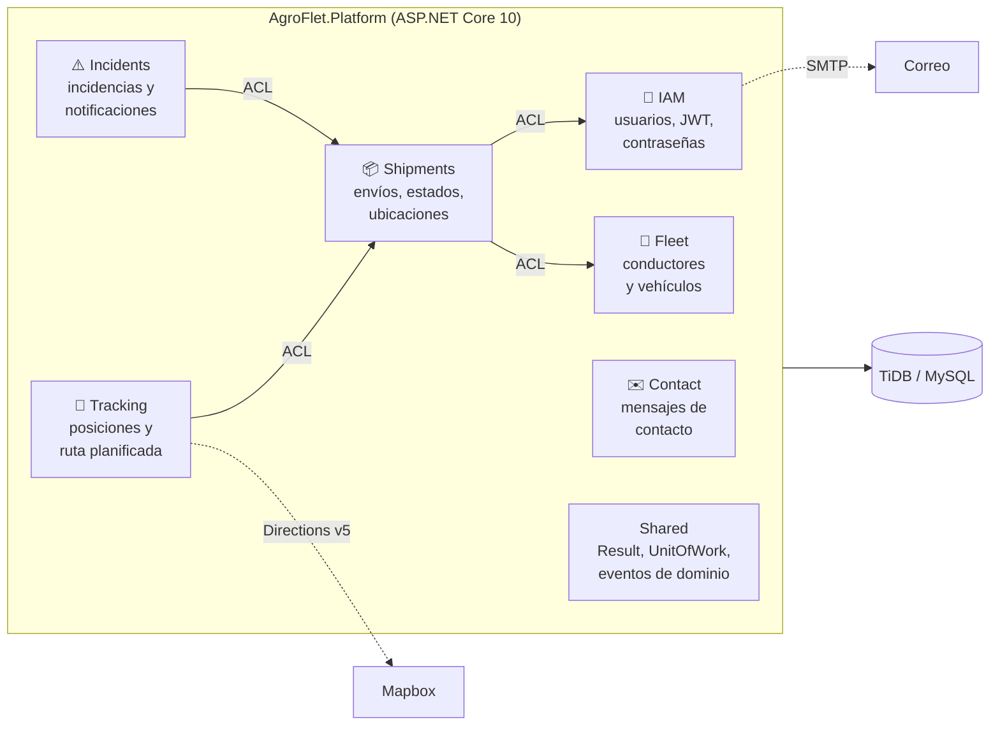
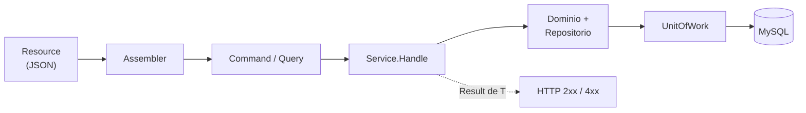

<p align="center">
  
</p>

<p align="center">
  <a href="https://agroflet-backend-application.onrender.com/health/live"></a>
  <a href="https://agroflet-backend-application.onrender.com/scalar/v1"></a>
  
  <a href="https://render.com"></a>
  <a href="https://docs.pingcap.com/tidbcloud/select-cluster-tier"></a>
</p>

<p align="center">
  <b>Backend REST de AgroFlet</b>: gestión de flota, envíos agrícolas, seguimiento de posiciones e incidencias,<br>
  construido en ASP.NET Core 10 con DDD, CQRS y Entity Framework Core sobre MySQL.
</p>

---

## 🚀 Pruébalo ahora

La API está desplegada y es pública:

| Recurso | Enlace |
| --- | --- |
| 🌐 URL base | https://agroflet-backend-application.onrender.com |
| 📖 Documentación interactiva (Scalar) | https://agroflet-backend-application.onrender.com/scalar/v1 |
| 🧾 Especificación OpenAPI | https://agroflet-backend-application.onrender.com/openapi/v1.json |

> [!NOTE]
> El servicio usa el plan gratuito de Render: si nadie lo usa durante un rato se duerme, y la primera petición puede tardar unos 50 segundos en responder. Las siguientes son inmediatas.

**En un minuto, desde Scalar:**

1. Abre [Scalar](https://agroflet-backend-application.onrender.com/scalar/v1) y ejecuta `POST /api/v1/auth/register` (`userType`: `dispatcher` o `buyer`).
2. Ejecuta `POST /api/v1/auth/login` y copia el `accessToken`.
3. Pulsa **Authorize**, pega el token y prueba `GET /api/v1/shipments`.

**O desde la terminal:**

```bash
API=https://agroflet-backend-application.onrender.com

curl -X POST $API/api/v1/auth/register -H "Content-Type: application/json" \
  -d '{"firstName":"Ana","lastName":"Demo","email":"ana@demo.com","password":"Secreta123!","userType":"dispatcher","preferredLanguage":"es"}'

TOKEN=$(curl -s -X POST $API/api/v1/auth/login -H "Content-Type: application/json" \
  -d '{"email":"ana@demo.com","password":"Secreta123!"}' | jq -r '.accessToken // .token')

curl $API/api/v1/shipments -H "Authorization: Bearer $TOKEN"
```



---

## ☁️ Cómo está desplegado

<p align="center">
  
</p>

| Pieza | Qué hace | Dónde está |
| --- | --- | --- |
| **GitHub** | Cada push a `main` dispara un nuevo despliegue. | [AGROFLET/Agroflet-backend-application](https://github.com/AGROFLET/Agroflet-backend-application) |
| **Blueprint de Render** | Declara el servicio web Docker, el plan Free, el health check y las variables. | [`render.yaml`](render.yaml) |
| **Imagen Docker** | Build multi-stage: compila con `dotnet/sdk:10.0` y ejecuta en `dotnet/aspnet:10.0` como usuario sin privilegios. Kestrel escucha en la variable `PORT` que inyecta Render. | [`Dockerfile`](Dockerfile) |
| **Render Web Service** | Ejecuta la API, aplica las migraciones de EF Core al arrancar y comprueba `/health/ready` antes de dar el despliegue por bueno. | [agroflet-backend-application.onrender.com](https://agroflet-backend-application.onrender.com/scalar/v1) |
| **TiDB Cloud Starter** | Base de datos gratuita compatible con MySQL (región `sa-east-1`, puerto 4000, conexión TLS). | [tidbcloud.com](https://tidbcloud.com) |

**Variables de entorno en Render** (los valores nunca se guardan en el repositorio):

| Variable | Valor |
| --- | --- |
| `ConnectionStrings__DefaultConnection` | `Server=<host>;Port=4000;Database=agroflet;User=<usuario>;Password=<clave>;SslMode=VerifyFull;` |
| `Jwt__Key` | Generada automáticamente por Render |
| `Database__ApplyMigrations` | `true` |
| `ASPNETCORE_ENVIRONMENT` | `Production` |
| `PORT` | `10000` |
| `Cors__AllowedOrigins__0` | URL del frontend |
| `PasswordReset__FrontendUrl` | URL de la pantalla de restablecer contraseña |
| `Mapbox__AccessToken` | Opcional, para calcular rutas |

¿Por qué TiDB y no otro MySQL? Render no ofrece MySQL gestionado y Aiven retiró su plan gratuito de MySQL. TiDB Cloud Starter es gratuito, no pide tarjeta y es compatible con el protocolo MySQL. Las dos migraciones se verificaron contra TiDB v8.5. La comparación completa de opciones y la guía paso a paso están en **[docs/DESPLIEGUE-RENDER.md](docs/DESPLIEGUE-RENDER.md)**.

---

## 🧩 Módulos



Cada módulo es un *bounded context* con la misma estructura (`Domain`, `Application`, `Infrastructure`, `Interfaces/Rest`) y se comunica con los demás solo a través de fachadas ACL.

<details>
<summary><b>📚 Endpoints principales</b> (haz clic para desplegar)</summary>

| Módulo | Método y ruta | Descripción |
| --- | --- | --- |
| IAM | `POST /api/v1/auth/register` | Registrar usuario (`dispatcher` o `buyer`) |
| IAM | `POST /api/v1/auth/login` | Iniciar sesión y obtener JWT |
| IAM | `POST /api/v1/auth/logout` | Cerrar sesión (revoca el token) |
| IAM | `GET /api/v1/users/profile` · `PUT /api/v1/users/profile` | Ver y editar el perfil |
| IAM | `PUT /api/v1/users/password` | Cambiar contraseña |
| IAM | `POST /api/v1/auth/password-reset-requests` · `POST /api/v1/auth/password-resets` | Recuperar contraseña |
| Fleet | `GET/POST /api/v1/drivers` · `GET/PATCH /api/v1/drivers/{id}` | Conductores |
| Fleet | `GET/POST /api/v1/vehicles` · `PATCH /api/v1/vehicles/{id}/status` | Vehículos y su estado |
| Shipments | `GET/POST /api/v1/shipments` · `GET/PATCH /api/v1/shipments/{id}` | Envíos |
| Shipments | `PATCH /api/v1/shipments/{id}/status` | Cambiar estado (la cancelación conserva el historial) |
| Shipments | `GET /api/v1/shipments/{id}/status-history` | Historial de estados |
| Shipments | `GET /api/v1/shipments/active/locations` | Ubicación de los envíos activos |
| Shipments | `GET /api/v1/locations` | Ubicaciones de origen y destino |
| Tracking | `GET/POST /api/v1/shipments/{id}/positions` · `GET /api/v1/positions` | Posiciones reportadas |
| Tracking | `GET /api/v1/shipments/{id}/planned-route` | Ruta planificada con Mapbox (GeoJSON, distancia, duración) |
| Incidents | `GET/POST /api/v1/shipments/{id}/incidents` · `GET /api/v1/incidents` | Incidencias |
| Incidents | `GET /api/v1/notifications` · `PATCH /api/v1/notifications/{id}/read` | Notificaciones internas |
| Contact | `POST /api/v1/contact-messages` | Formulario de contacto (con límite de peticiones) |
| Salud | `GET /health/live` · `GET /health/ready` | Proceso vivo · base de datos accesible |

La lista completa, con esquemas y ejemplos, está en [Scalar](https://agroflet-backend-application.onrender.com/scalar/v1).

</details>

---

## 🏗️ Arquitectura

```text
Agroflet.Platform/
  Iam/ Fleet/ Shipments/ Tracking/ Incidents/ Contact/
    Domain/Model/                 Agregados, Commands, Queries, Events
    Domain/Repositories/          Contratos de persistencia
    Application/CommandServices/  Contratos de escritura
    Application/QueryServices/    Contratos de consulta
    Application/Internal/         Implementaciones y servicios salientes
    Infrastructure/Persistence/EntityFrameworkCore/
    Interfaces/Rest/              Controllers, Resources, Transform
  Shared/                         Result, eventos, UnitOfWork, errores
  Migrations/                     Migraciones EF Core y snapshot
Agroflet.Platform.Tests/          Pruebas de integración (xUnit)
```



- Los resultados esperados usan `Result<T>` y los assemblers REST los traducen a códigos HTTP. Los fallos inesperados se manejan de forma centralizada.
- Seguridad: JWT Bearer, contraseñas con BCrypt, revocación de sesiones al cerrar sesión, CORS configurable y límite de peticiones en autenticación y contacto.
- Se usan GET, POST, PATCH y PUT. No hay DELETE físico de envíos: la cancelación es un PATCH con motivo que conserva el historial.

---

## 💻 Ejecutar en local

**Requisitos:** SDK de .NET 10 y MySQL 8 (o Docker).

<details>
<summary><b>Opción A · Rider o Visual Studio con MySQL local</b></summary>

1. Crea la base con `database/crear-base.sql` desde MySQL Workbench.
2. En PowerShell, en la raíz del repositorio:

   ```powershell
   .\configurar-local.ps1 -Usuario root -Puerto 3306
   ```

   El script pide tu contraseña y crea `Agroflet.Platform/appsettings.Local.json` (excluido de Git) con la cadena de conexión y una clave JWT aleatoria. Para actualizarlo más adelante usa `-Actualizar`.
3. Abre `agroflet_backend1.sln`, selecciona el perfil **http** de `Agroflet.Platform` y ejecuta. Las migraciones se aplican solas.
4. Abre http://localhost:5080/scalar/v1 y comprueba http://localhost:5080/health/ready.

Errores comunes: `1045` significa credenciales rechazadas y `1044`, permisos insuficientes sobre la base. No borres el historial de migraciones para resolverlos.

</details>

<details>
<summary><b>Opción B · Docker (igual que en Render)</b></summary>

```bash
docker network create agroflet
docker run -d --name mysql --network agroflet -e MYSQL_ROOT_PASSWORD=root -e MYSQL_DATABASE=agroflet mysql:8.4

docker build -t agroflet-api .
docker run --rm -p 10000:10000 --network agroflet \
  -e ConnectionStrings__DefaultConnection="Server=mysql;Port=3306;Database=agroflet;User=root;Password=root;" \
  -e Jwt__Key="$(openssl rand -base64 48)" \
  -e Database__ApplyMigrations=true \
  agroflet-api
```

Luego abre http://localhost:10000/scalar/v1.

</details>

### Integraciones opcionales

- **Mapbox Directions v5** (perfil `mapbox/driving`): configura `Mapbox:AccessToken` solo en el servidor. Sin token, `GET /api/v1/shipments/{id}/planned-route` responde que el proveedor no está configurado; nunca inventa rutas. [Documentación de Mapbox](https://docs.mapbox.com/api/navigation/directions/).
- **SMTP** para recuperar contraseñas: configura la sección `Smtp`. En Development, el token puede devolverse en la respuesta para pruebas.

Ninguna de las dos es necesaria para arrancar el backend.

---

## 🧪 Pruebas

```bash
dotnet test agroflet_backend1.sln -c Release -m:1
```

Las pruebas usan SQLite aislado. Para probar contra MySQL, `TEST_MYSQL_CONNECTION` debe apuntar solo a una base desechable `agroflet_tests_<sufijo>`, porque el fixture la borra y la reconstruye. Los resultados están en [docs/VALIDACION.md](docs/VALIDACION.md).

---

## 📂 Documentación

| Documento | Contenido |
| --- | --- |
| [DESPLIEGUE-RENDER.md](docs/DESPLIEGUE-RENDER.md) | Guía de despliegue, opciones de base de datos y evidencias |
| [ALINEACION-LEARNING-CENTER.md](docs/ALINEACION-LEARNING-CENTER.md) | Coincidencias y adaptaciones respecto al patrón Learning Center |
| [TRAZABILIDAD-AV2.md](docs/TRAZABILIDAD-AV2.md) | Trazabilidad de las historias TS01–TS27 |
| [COMPATIBILIDAD-FRONTEND.md](docs/COMPATIBILIDAD-FRONTEND.md) | Contratos compartidos con el frontend |
| [VALIDACION.md](docs/VALIDACION.md) | Pruebas ejecutadas y resultados |
| [REPORTE-CAMBIOS.md](docs/REPORTE-CAMBIOS.md) | Texto para el reporte del proyecto |

Licencias de terceros en [`licenses/`](licenses).
